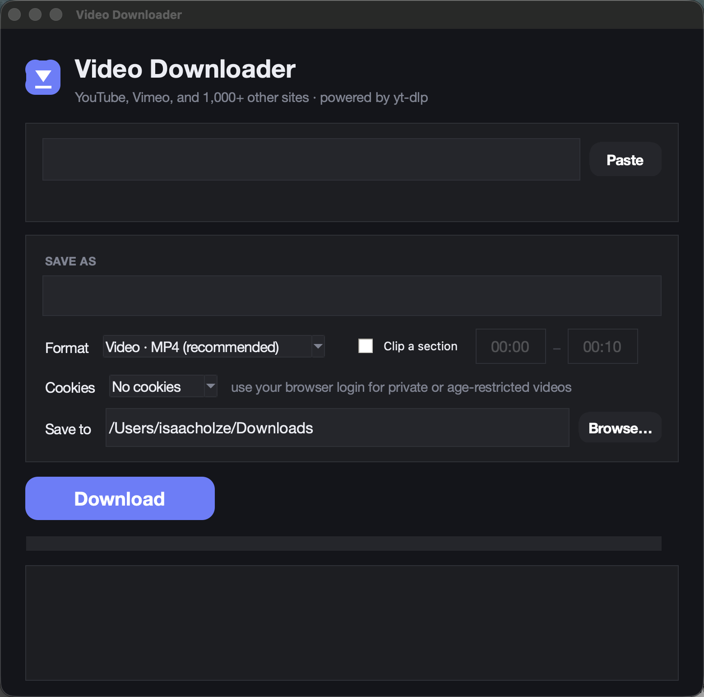

# Video Downloader for macOS

A small, dark-themed macOS app for downloading video or audio from YouTube,
Vimeo, and the 1,000+ other sites [yt-dlp](https://github.com/yt-dlp/yt-dlp)
supports.



## Share it / install it

Send someone **one file**: `install-video-downloader.sh` (it has the whole app
and icon embedded). They need [Homebrew](https://brew.sh), then:

```bash
bash install-video-downloader.sh
```

The installer checks for Python (with tkinter), yt-dlp, and ffmpeg, installs
any that are missing via Homebrew, and creates `/Applications/Video
Downloader.app`. Launch it from Applications or Spotlight.

## Features

- **Any site yt-dlp supports** — YouTube, Dailymotion, Internet Archive,
  Twitter/X, TikTok, and hundreds more. Paste a URL; if yt-dlp can read it,
  the app can download it.
- **Auto-naming that follows the source** — when you paste a URL, the app
  fetches the video's title and fills the filename. Paste a different URL and
  the name updates to the new video. If you type your own name, it's left
  alone.
- **Formats** — MP4 (h264 + AAC, QuickTime/Resolve-friendly, the default),
  MOV, MKV, WebM, or audio-only M4A/MP3.
- **Clip a section** — check "Clip a section" and give start/end times
  (MM:SS or HH:MM:SS). Uses keyframe-accurate cuts.
- **Browser cookies** — for private, members-only, or age-restricted videos,
  pick Chrome/Safari/Firefox under "Cookies" to reuse your browser login.
  (macOS may ask for keychain or disk access the first time.)
- **Progress bar + live log**, a Cancel button, and **Reveal in Finder** when
  the download lands.
- Existing files are never overwritten — a ` (1)`, ` (2)`… suffix is added.

## Development

- `video_downloader.py` — the app (plain Python + tkinter, no pip packages).
- `make-installer.sh` — regenerates `install-video-downloader.sh` from the
  current source and `AppIcon.icns`. Run it after any code change, then run
  the installer to update the installed app.
- `AppIcon.icns` / `icon_1024.png` — the app icon (generated artwork, masked
  to the macOS 824-px squircle grid and packed with `iconutil`).

## Known limits

- **Vimeo** without login frequently returns 401 — yt-dlp needs browser
  impersonation that the Homebrew build lacks. Setting Cookies to your
  browser usually gets around it.
- Site support comes from yt-dlp; when a site changes and breaks, update with
  `brew upgrade yt-dlp`.

## Uninstall

```bash
rm -rf "/Applications/Video Downloader.app"
```

## Notes

Runs entirely locally; talks only to the video site. Respect each site's
terms of service and copyright when downloading.

MIT licensed — see [LICENSE](LICENSE).
